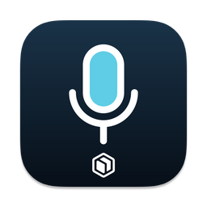

<div align="center">
  
  <h1>ForIT Dictate</h1>
  <p>ForIT's Mac dictation app, built from VoiceInk</p>

  [](https://www.gnu.org/licenses/gpl-3.0)
  
</div>

ForIT Dictate is ForIT's Mac dictation app. Press the shortcut and speak, and the text is typed into whatever text field has focus. It is ForIT's build of [VoiceInk](https://github.com/Beingpax/VoiceInk) by Prakash Joshi Pax, released under the GNU General Public License v3.0, and this repository is its complete source.

It is for Ben and ForIT staff, and it only does dictation. Meeting recording lives in ForIT Notes.

## What is different from VoiceInk

Transcription is local only. Speech is transcribed on the Mac with whisper.cpp, Parakeet, transcribe.cpp or Apple Speech, and AI cleanup runs on the Mac too, with VoiceInk Refine or an Ollama server on the same Mac. The cloud speech and LLM providers, custom endpoints and the CLI provider are hidden, so dictated audio and text stay on the Mac. To approve a provider, add it in `VoiceInk/App/Configuration/ForITProviderPolicy.swift`.

There is no licence, trial or updater. The paid licence and trial checks are gone, along with the Sparkle updater, the announcements feed, the GitHub star prompt and the changelog popup. The app makes no automatic calls to upstream services.

Builds are signed with ForIT's Developer ID (team UUSSWWML2A), notarized by Apple, and identified as `io.forit.dictate`. Settings, history and the dictionary stay on the Mac, and nothing syncs through iCloud.

## Install

Get the original DMG, its matching `.dmg.sha256` file and verified release receipt
from the maintained Mini release (ForIT staff only). Keep the two files together.
Finish any active dictation and close the app through the device owner's normal
flow before installing:

```bash
scripts/forit-install.sh ForIT-Dictate-<version>-<build>.dmg
```

Before it copies the app to /Applications, the script requires the matching checksum, ForIT's Developer ID signatures and Apple's stapled tickets for both the DMG and app. It refuses to replace a running app and leaves the installed app closed. It preserves the app's history, models and settings. On first launch, allow Microphone and Accessibility when macOS asks. Accessibility is what lets the app type into other apps.

## How a release is built

`scripts/forit-mini-release.sh BUILD` is the app-owned adapter for the shared Apple build launcher. It uses the Mac's existing signing identity and notary key. The release script runs the synthetic tests, builds pinned whisper.cpp and the app, signs code from the inside out, then notarizes and staples both the app and DMG. It verifies the actual app build number and preserves public source, signing, Apple receipts and checksums. GitHub Actions does not run Apple builds. See [the adapter contract](docs/apple-release-adapter.md) for the required existing slot, Common checks and retained evidence. The registered route still needs exact-commit native proof.

The version is in `forit/VERSION`. The release owner reserves an explicit build
number against the existing release records and passes it to the adapter; a
shallow checkout's commit count is not a build number.

## License and credits

ForIT Dictate is licensed under the GNU General Public License v3.0, like VoiceInk; see [LICENSE](LICENSE). Each DMG includes a copy of the licence. Credit for the app itself goes to Prakash Joshi Pax and the VoiceInk contributors. ForIT's changes are the commits in this repository on top of upstream.

To build it yourself without ForIT's signature, see [BUILDING.md](BUILDING.md).

## VoiceInk acknowledgments

### Core Technology
- [whisper.cpp](https://github.com/ggerganov/whisper.cpp) - High-performance inference of OpenAI's Whisper model
- [FluidAudio](https://github.com/FluidInference/FluidAudio) - Used for Parakeet model implementation
- [TranscribeCpp for Swift](https://github.com/Beingpax/Transcribe-cpp-swift) - SwiftPM distribution of [transcribe.cpp](https://github.com/handy-computer/transcribe.cpp), used for local GGUF transcription models
- [SenseVoice Small](https://huggingface.co/FunAudioLLM/SenseVoiceSmall) by FunAudioLLM / Alibaba - Multilingual model available under the [FunASR Model Open Source License Agreement](https://github.com/modelscope/FunASR/blob/main/MODEL_LICENSE)

### Essential Dependencies
- [KeyboardShortcuts](https://github.com/sindresorhus/KeyboardShortcuts) - User-customizable keyboard shortcuts
- [LaunchAtLogin](https://github.com/sindresorhus/LaunchAtLogin) - Launch at login functionality
- [MediaRemoteAdapter](https://github.com/ejbills/mediaremote-adapter) - Media playback control during recording
- [Zip](https://github.com/marmelroy/Zip) - File compression and decompression utilities
- [SelectedTextKit](https://github.com/tisfeng/SelectedTextKit) - A modern macOS library for getting selected text
- [Swift Atomics](https://github.com/apple/swift-atomics) - Low-level atomic operations for thread-safe concurrent programming


---

Made with ❤️ by Pax
